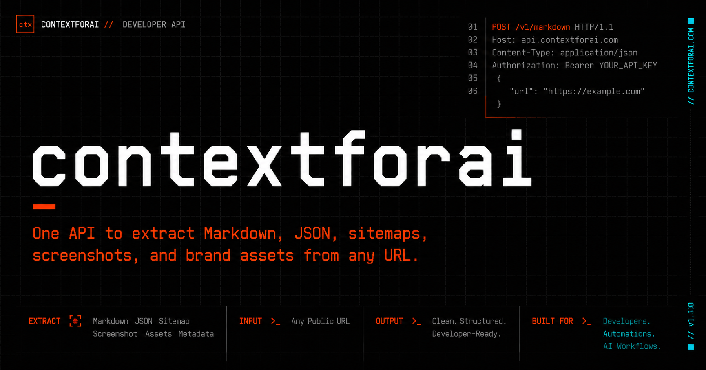

# contextforai

One API to extract structured data from any URL — clean Markdown, raw HTML, structured JSON, sitemaps, screenshots, and brand assets. Single API key, credit-based billing, per-plan rate limits.

## Features

- Markdown extraction — clean Markdown via Readability, boilerplate stripped
- Raw HTML extraction — unparsed page HTML
- Structured JSON — title, meta tags, OpenGraph, headings, links
- Sitemap extraction — page list from sitemap.xml, falls back to shallow crawl
- Font detection — font families from CSS and Google Fonts links
- Screenshots — full-page or viewport PNG via headless Chromium
- Brand assets — logo, favicon, dominant brand colors
- Credit-based billing with per-plan rate limits
- SSRF protection and Redis-backed rate limiting

## Author

**Ashutosh Swamy**

- [GitHub](https://github.com/ashutoshswamy)
- [LinkedIn](https://linkedin.com/in/ashutoshswamy)
- [X](https://x.com/ashutoshswamy_)
- [Portfolio](https://ashutoshswamy.in)

## License

Private project, all rights reserved.
